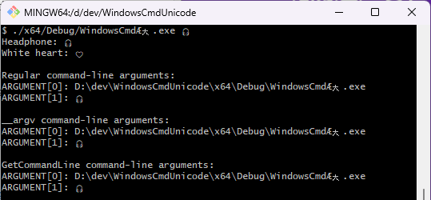

Small command-line tool for testing of the folllowing:
* Pass unicode characters as command-line arguments. The executable filename already has a `Æ大` suffix which should automatically show up in `argv[0]`.
* Print >2 byte (non-BMP) "surrogate" unicode characters like white heart `🤍` ([U+1F90D](https://graphemica.com/%F0%9F%A4%8D)) or headphone `🎧` ([U+1F3A7](https://graphemica.com/%F0%9F%8E%A7)) back to the console.



### Detected issues

|         Issue             |       Workaround       |
|---------------------------|------------------------|
| Non-ASCII characters in `argv[]` command-line arguments are truncated to `?` if using `int main(int argc, char* argv[])` as entry point. | Instead use `int wmain(int argc, wchar_t* argv[])` as entry point. |
| `wprintf` & `std::wcout` unable to print >2 byte (non-BMP) "surrogate" characters to Windows command prompt. | Use `WriteConsoleW` instead of `wprintf` or switch to bash shell. |

Please contact the repo author if you discover more problems or are aware of better solutions or workarounds.

## UTF-8 display in Command Prompt
First need to change the active code page with [`chcp 65001`](https://learn.microsoft.com/en-us/windows/win32/intl/code-page-identifiers) to activate UTF-8 mode.
```
> chcp 65001
Active code page: 65001

> type UTF-8_BOM.txt
 Kåre Sæther er en ørn 🎧🤍.
> type UTF-8.txt
Kåre Sæther er en ørn 🎧🤍.
```

The default code page appear to be [`437`](https://en.wikipedia.org/wiki/Code_page_437) (extended ASCII).

## UTF-16 display in Command Prompt
UTF-16 LE display **works out-of-the-box**, including >2 byte (non-BMP) "surrogate" unicode characters:
```
> type UTF-16_LE.txt
Kåre Sæther er en ørn 🤍.
```

UTF-16 BE display does _not_ work by default.

## Links
* [Windows Command-Line: Unicode and UTF-8 Output Text Buffer](https://devblogs.microsoft.com/commandline/windows-command-line-unicode-and-utf-8-output-text-buffer/)

## Windows Terminal issues
* [Issue with Printing Emojis on Windows Console](https://github.com/microsoft/terminal/issues/18124) - closed but not fixed
* [Emojis are not displayed when using wide string output](https://github.com/microsoft/terminal/issues/12457) - closed but not fixed
